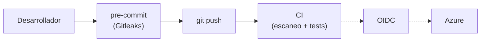

# Kit DevSecOps para proyectos académicos

[](../../actions/workflows/secret-scan.yml)
[](../../actions/workflows/tests.yml)
[](LICENSE)

Permite a un equipo partir un proyecto de Python con Azure Functions sin
credenciales en Git, con controles de secretos en local y en CI desde el primer
commit. La versión actual es la 0.7.4.

## Qué incluye

- Escaneo de secretos local con pre-commit y Gitleaks.
- Workflow de escaneo en GitHub Actions, listo para exigirse como check obligatorio antes del merge.
- Perfil Bicep para Azure Functions Flex Consumption (Python 3.12, `brazilsouth`).
- Autenticación GitHub–Azure con OIDC, sin secretos permanentes en el repositorio.
- Configuración cifrada opcional con SOPS y destinatarios `age`.
- Acciones y binarios de CI fijados por commit y SHA-256.
- Ejemplo HTTP `/api/health` con pruebas.
- ADRs en [`docs/adr/`](docs/adr) y [modelo de amenazas](docs/THREAT_MODEL.md).

El generador también deja su runtime dentro del proyecto y se niega a
sobrescribir archivos que el equipo ya modificó.

## Cómo fluye



Las flechas punteadas corresponden a los workflows de Azure, que el equipo
activa después de adaptarlos.

## Inicio rápido

Hay dos recorridos:

1. **Prueba local:** comprobar que el kit genera archivos, compila el plan y
   ejecuta el ejemplo sin Azure. Es lo que cubre esta sección.
2. **Proyecto de equipo:** revisar lo generado, sustituir el ejemplo por código
   propio, probarlo y recién entonces subir un repositorio privado. La sección
   «Del ejemplo a un repositorio de equipo» explica qué se edita.

Así se ve la generación en local, sin Azure ni claves:

```text
$ python -m framework.starter_kit doctor --mode local
Mode: local
- python: ok (required)
- git: ok (required)
Ready

$ python -m framework.starter_kit generate --config project.json --output proyecto
Generated 32 files in proyecto
SOPS configuration omitted because no public recipients were supplied.
No remote resources were changed.
```

### Requisitos

- Python 3.11 o posterior y Git.
- Azure CLI con Bicep disponible localmente, para llegar hasta `plan` (solo compila infraestructura).
- `pre-commit`, al instalar el hook en un repositorio Git.

### Demo en cinco pasos

En Windows, abre PowerShell en la raíz de este repositorio y copia el siguiente
bloque. Crea una carpeta temporal nueva en cada ejecución, no necesita claves,
no publica un repositorio y no crea recursos Cloud.

```powershell
$demoRoot = Join-Path ([System.IO.Path]::GetTempPath()) ('feria-kit-' + [guid]::NewGuid().ToString('N').Substring(0, 8))
$expiryDate = (Get-Date).AddDays(30).ToString('yyyy-MM-dd')
$inputConfig = Join-Path $demoRoot 'entrada/feria-project.json'
$projectDir = Join-Path $demoRoot 'proyecto'

python -m framework.starter_kit doctor --mode local
python -m framework.starter_kit init --name feria-ejemplo --expires-on $expiryDate --non-interactive --output $inputConfig
python -m framework.starter_kit generate --config $inputConfig --output $projectDir
python -m framework.starter_kit plan --config (Join-Path $projectDir 'feria-project.json') --output (Join-Path $projectDir '.feria/plan.json')
```

`doctor` comprueba lo básico; `init` guarda decisiones no secretas; `generate`
crea el proyecto; `plan` compila Bicep localmente, sin `--what-if` ni acceso a
Azure Resource Manager. Después, en la misma sesión, entra al proyecto:

```powershell
Set-Location $projectDir
Test-Path .\.feria\plan.json
python -m unittest discover -s tests -p "test_*.py"
Get-Content .\README.md
```

`Test-Path` debe mostrar `True`. Si abriste otra terminal y `$projectDir` ya no
existe, entra manualmente en la carpeta `proyecto` generada y ejecuta solo los
tres comandos relativos de las últimas líneas. Allí hay un `README.md` propio
que explica qué editar. En esta prueba no debería existir `.sops.yaml`: SOPS
solo se configura si proporcionas destinatarios públicos `age`.

No edites la carpeta temporal para concluir la prueba. Si quieres
repetir `generate`, hazlo antes de tocar archivos; el manifiesto debe permanecer
igual. Una vez que el equipo modifica un archivo generado, el kit rechaza la
sobrescritura para proteger su trabajo: genera otra propuesta en otra carpeta y
revisa diferencias en lugar de borrar cambios.

### Si algo falla

- `doctor` dice «Ready» pero `plan` falla: comprueba `az bicep version`.
- `init` indica fecha pendiente: usa un `expires_on` futuro.
- Otro archivo ya existe y difiere: el generador se detiene sin sobrescribirlo.

## Del ejemplo a un repositorio de equipo

La guía detallada está en el `README.md` del proyecto generado. Esta tabla
resume las responsabilidades:

| Ruta | Acción del equipo |
|---|---|
| `app/` | Desarrollar la lógica Python propia. `health.py` es un ejemplo reemplazable. |
| `function_app.py` | Registrar rutas HTTP para Azure Functions y conectar `app/`. |
| `tests/` | Probar el comportamiento de la aplicación del equipo. |
| `requirements.txt` | Añadir dependencias revisando compatibilidad con Python 3.12. |
| `feria-project.json` | Revisar nombre, ambiente y vencimiento; para cambiarlos, ajustar la entrada y generar en otra carpeta. No desincronizar este JSON de Bicep. |
| `.env.example` | Documentar nombres de variables sin valores sensibles. |
| `framework/`, `.feria/` | Runtime y manifiesto del kit; no programar aquí. |
| `infra/`, `.github/workflows/` | Infraestructura y controles; revisar antes de modificarlos. |
| `examples/azure-workflows/` | Demos inactivas; no copiar sin configuración OIDC, revisión de permisos y costos. |

Para un **proyecto nuevo de Python Functions**, el equipo puede convertir la
carpeta generada en su repositorio privado después de adaptar el ejemplo. El
README generado contiene la secuencia exacta para preparar Git, instalar el
hook, revisar los archivos staged, crear un repositorio privado vacío y hacer
el primer push. Al subirlo, hay que comprobar que el escaneo CI se ejecuta y,
si los permisos del repositorio lo permiten, exigirlo antes del merge. La
carpeta temporal de la demo no debe subirse sin esa revisión.

Para una **aplicación existente o un stack distinto**, genera primero en una
carpeta separada. Integra solo los controles compatibles sobre una rama de
trabajo; no copies el código a `framework/` ni reemplaces la estructura de la
aplicación. El generador detecta colisiones de contenido.

Para llegar a Azure, consulta [OIDC](docs/OIDC.md) y el
[ciclo Azure](docs/AZURE_LIFECYCLE.md), verifica tu propia suscripción,
permisos y cuotas, y revisa `what-if` antes de solicitar `apply`.

SOPS es opcional cuando no necesitas versionar configuración sensible. La
[guía SOPS](docs/SOPS.md) explica destinatarios públicos, respaldo y
recuperación. `local.settings.json` queda excluido y bloqueado por el control
local. La [guía de escaneo](docs/CI_SECRET_SCANNING.md) explica el gate.

## Decisiones técnicas

El perfil de Azure es deliberadamente pequeño: Functions Flex Consumption con
Python 3.12, 512 MB, una instancia máxima y sin instancias siempre activas, para
que quepa en créditos estudiantiles, sin depender de Pay-As-You-Go, y se pueda
crear y destruir de forma reproducible. Dejé la base de datos fuera
(`database_profile=none`) porque la consulta de SKUs de MySQL falló en tres
regiones y no aportaba a lo que había que demostrar, que eran los controles de
credenciales; el trade-off es que el ejemplo no cubre una aplicación con
persistencia.

La autenticación entre GitHub y Azure usa OIDC, sin un secreto permanente en el
repositorio, y los workflows que tocan Azure son demos de ejecución manual,
inactivas hasta que el equipo las adapta. Para la configuración sensible elegí
SOPS con destinatarios `age` individuales: es gratuito y portable, pero deja la
custodia de las claves en cada persona, así que la clave de CI tiene alcance
propio y los respaldos se documentan en la [guía SOPS](docs/SOPS.md).

En CI, las acciones y los binarios descargados van fijados por commit y SHA-256
(ver [modelo de amenazas](docs/THREAT_MODEL.md)), y el generador se niega a
sobrescribir archivos que el equipo ya modificó. Cada decisión con su contexto y
su criterio de reversión está en [`docs/adr/`](docs/adr).

## Origen

El kit nació de mi Trabajo de Título sobre prevención de fugas de credenciales
en proyectos académicos con GitHub y Azure, aprobado con nota máxima. El caso
de estudio fue PyroPrev, un proyecto de otro equipo; el kit genera un esqueleto
nuevo y no incluye su código. Los nombres `feria-*` y `.feria/` vienen de ese
contexto (la Feria de Software de la universidad) y se mantienen por
compatibilidad.

## Limitaciones

- El único perfil validado es Azure Functions Flex Consumption en `brazilsouth`, Python 3.12 y base de datos `none`; no se puede elegir cualquier servicio, base de datos o región.
- Los workflows OIDC y de ciclo Azure son ejemplos inactivos en `examples/azure-workflows/`; contienen valores del ensayo y requieren adaptación antes de copiarlos a `.github/workflows/`.
- El kit no publica código de aplicación en Azure ni es una aplicación ya publicada; subir el repositorio y programar no equivale a desplegar, porque falta integrar y probar la publicación del código.
- `doctor --mode local` comprueba Python y Git, pero no Azure CLI, Bicep ni `pre-commit`; la prueba no requiere instalar ni actualizar nada sin decidirlo antes.
- Completar la prueba local no es motivo para ejecutar `apply` o `destroy`; ambos requieren revisar antes `what-if`, la suscripción, los permisos y las cuotas.
- Las claves privadas, tokens reales y archivos `.env` históricos no deben entrar al kit ni a Git.
- El generador no puede decidir la arquitectura de cualquier equipo; PyroPrev requirió una adaptación controlada, no un solo comando.
- La evidencia experimental completa del Trabajo de Título no se incluye en este repositorio.
- La generación automatizada, la prueba manual del autor y este ejemplo no prueban por sí solos facilidad de adopción para todos los equipos ni funcionamiento Cloud del nuevo esqueleto.

## Más información

- [SECURITY.md](SECURITY.md): política de seguridad; consúltala antes de usar el kit.
- [`docs/`](docs): arquitectura, alcance, OIDC, ciclo Azure, SOPS, escaneo en CI, modelo de amenazas y ADRs.
